# EcoMarket 🌱

## 1. Descripción del proyecto

EcoMarket es una tienda web de productos ecológicos, reutilizables y sustentables. Su objetivo es presentar alternativas que fomenten el consumo responsable mediante una interfaz visualmente agradable, organizada y fácil de navegar.

El sitio permite explorar productos, conocer información sobre el proyecto y consultar los medios de contacto disponibles.

## 2. Páginas del sitio

- **Inicio:** presentación de EcoMarket.
- **Productos:** catálogo de productos ecológicos y reutilizables.
- **Sobre nosotros:** información sobre el proyecto.
- **Contacto:** información de contacto y formulario.

## 3. Tecnologías utilizadas

- **HTML5:** estructura y contenido de las páginas.
- **CSS3:** diseño visual, colores, distribución y estilos.
- **Flexbox y CSS Grid:** organización de los elementos.
- **Media Queries:** adaptación del diseño a diferentes tamaños de pantalla.
- **Git y GitHub:** control de versiones y almacenamiento del código fuente.

El proyecto se desarrolla sin JavaScript, de acuerdo con los requisitos establecidos.

## 4. Estructura del proyecto

El proyecto EcoMarket está organizado en carpetas para separar los archivos de estilos, las imágenes y las páginas HTML, facilitando su mantenimiento y modificación.

```text
EcoMarket/
├── css/
│   ├── main.css
│   ├── layout.css
│   ├── components.css
│   └── animations.css
├── img/
│   ├── products/
│   ├── icons/
│   ├── hero/
│   └── mockoups/
├── views/
│   ├── productos.html
│   ├── sobre-nosotros.html
│   └── contacto.html
├── index.html
└── README.md
```

### Descripción de las carpetas

- **`css/`**: contiene los archivos CSS que definen los estilos, la distribución y la apariencia visual del sitio.
- **`img/`**: almacena las imágenes utilizadas en el proyecto, como fotografías de productos, iconos e imágenes de portada.
- **`views/`**: contiene las páginas secundarias de la tienda.
- **`index.html`**: es la página principal de EcoMarket.
- **`README.md`**: documenta el proyecto, sus tecnologías, su estructura y las instrucciones de visualización.

## 5. Instrucciones de visualización

### Visualización local

1. Descargar o clonar el repositorio.
2. Abrir la carpeta del proyecto en Visual Studio Code.
3. Abrir el archivo `index.html` en un navegador.
4. Utilizar el menú de navegación para acceder a las diferentes páginas.

### Sitio publicado

https://ecomarketproyecto.netlify.app/

## 6. Capturas de pantalla

Las siguientes capturas presentan los diseños iniciales (mockups) y las páginas implementadas de EcoMarket, tanto en escritorio como en dispositivos móviles.

### 6.1. Vista de escritorio

#### Página de inicio

**Mockup:**

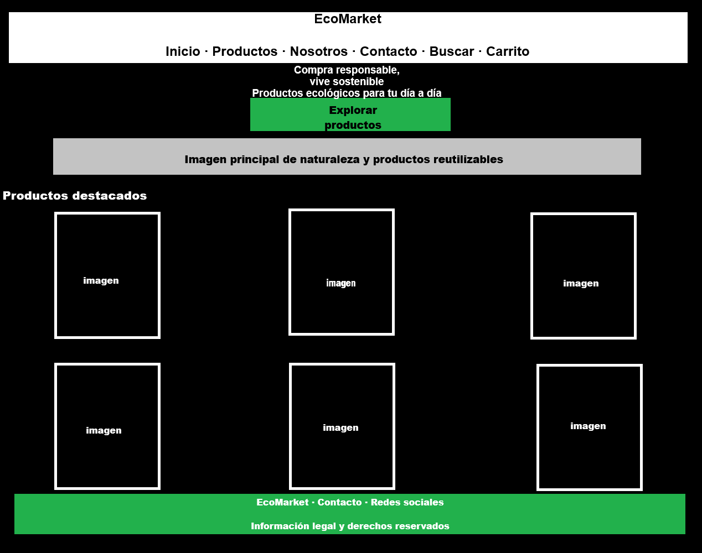

**Implementación:**

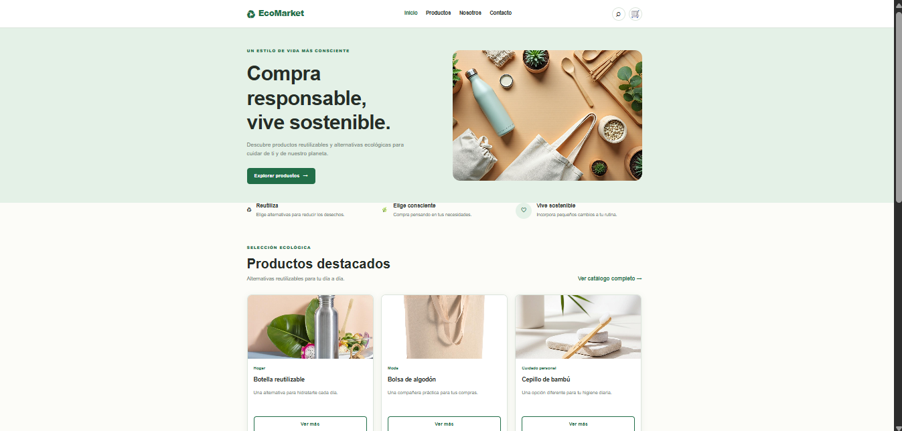

#### Catálogo de productos

**Mockup:**

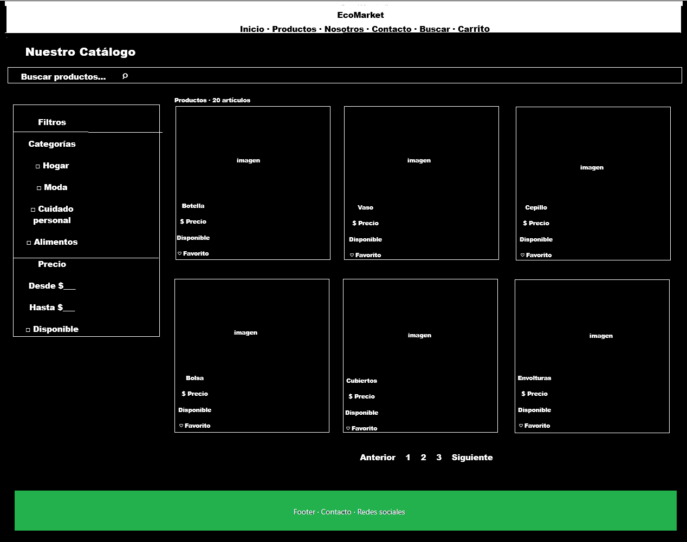

**Implementación:**

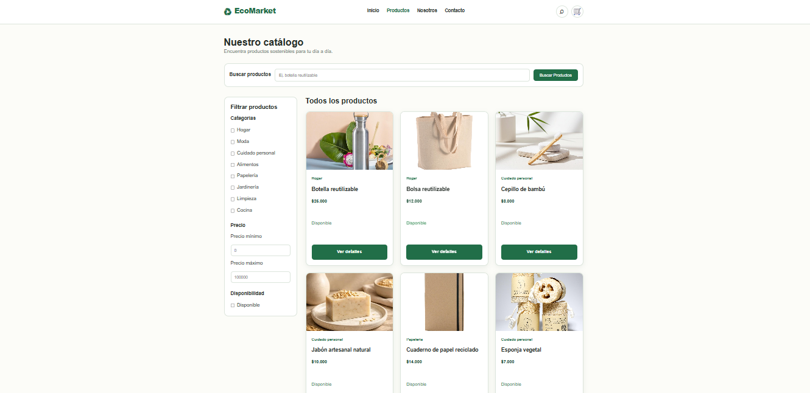

#### Sobre nosotros

**Mockup:**

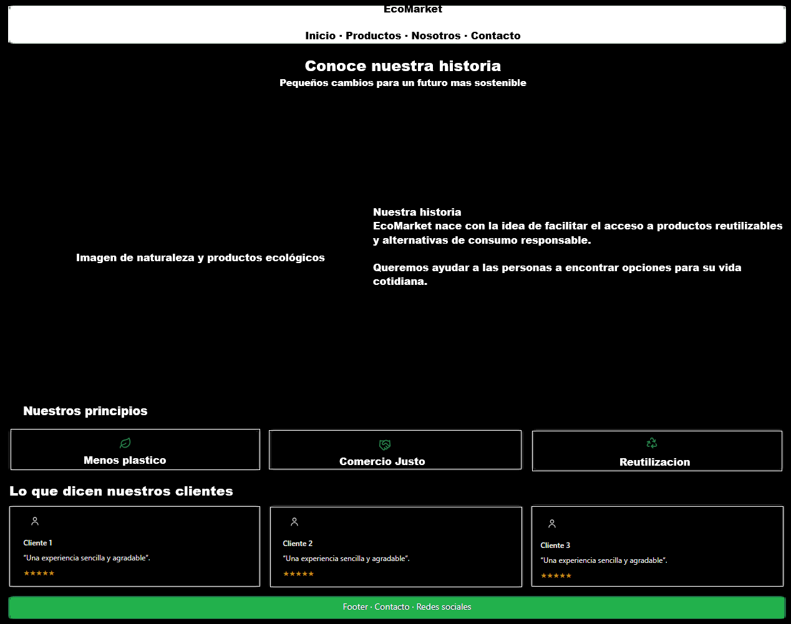

**Implementación:**

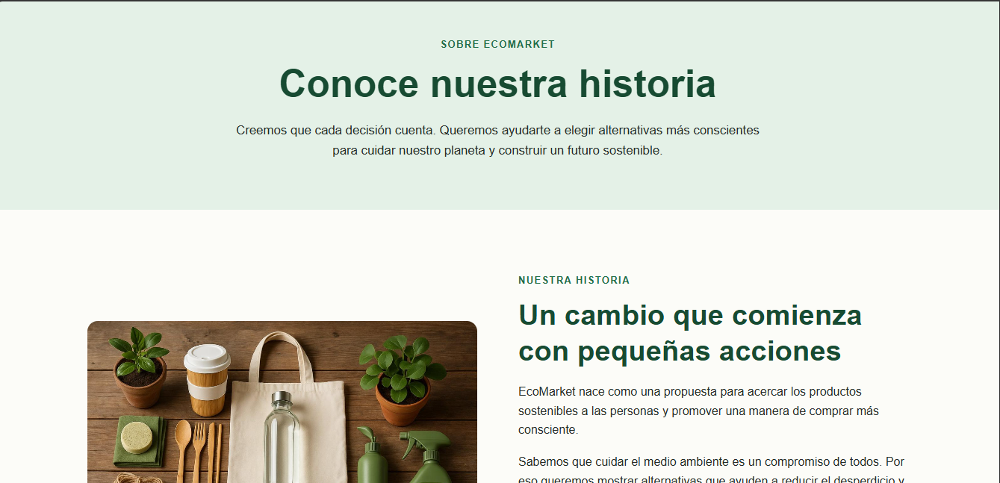

#### Contacto

**Mockup:**

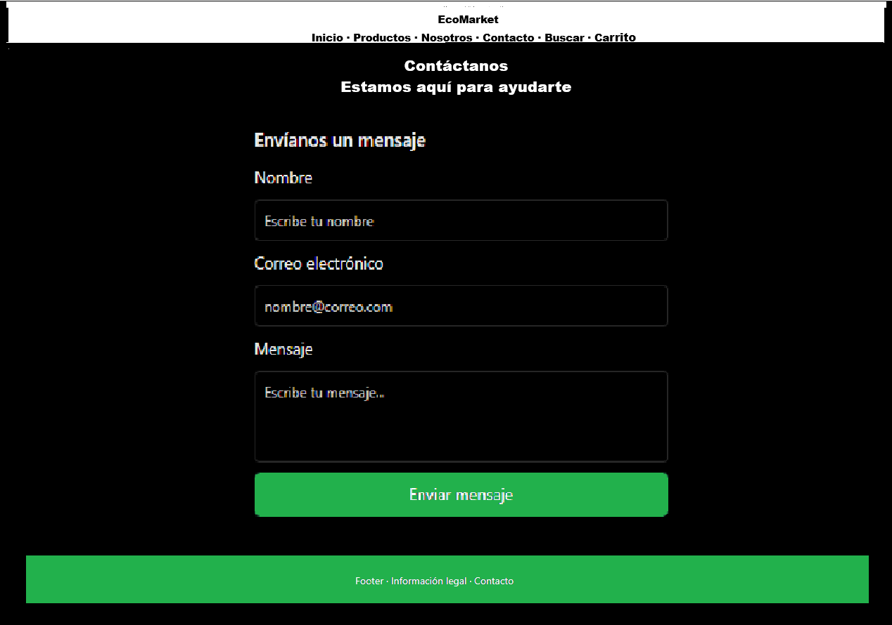

**Implementación:**

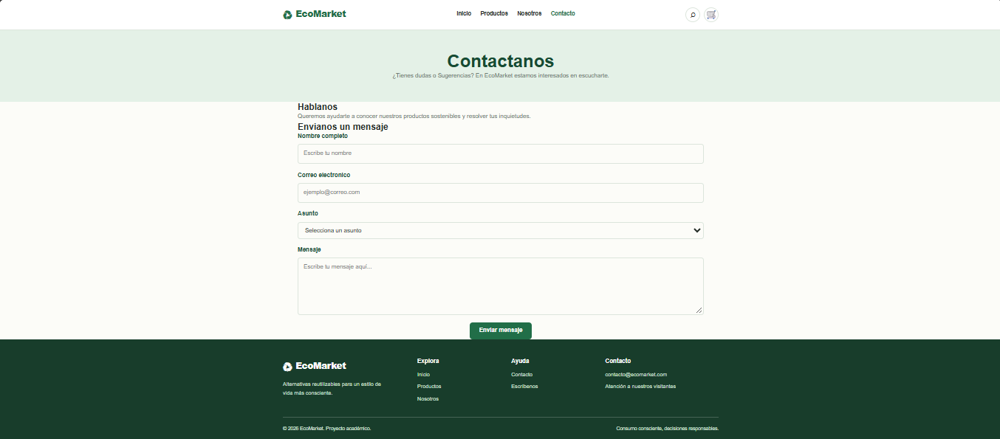

### 6.2. Vista móvil

#### Página de inicio

**Mockup:**

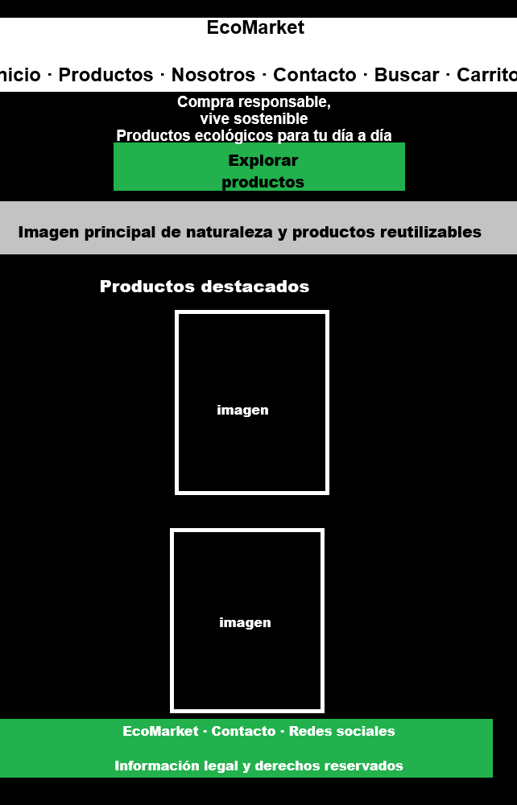

**Implementación:**

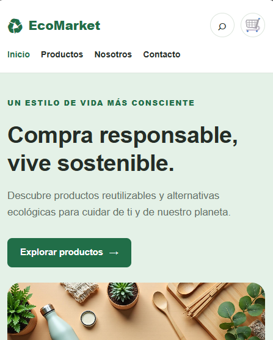

#### Catálogo de productos

**Mockup:**

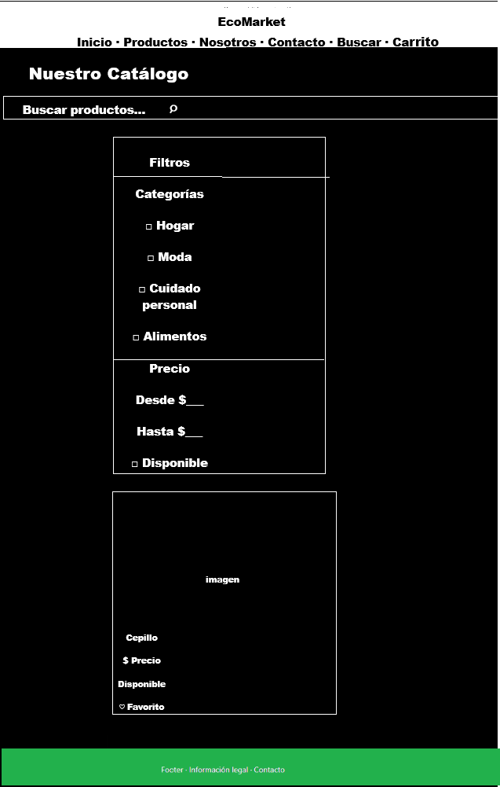

**Implementación:**

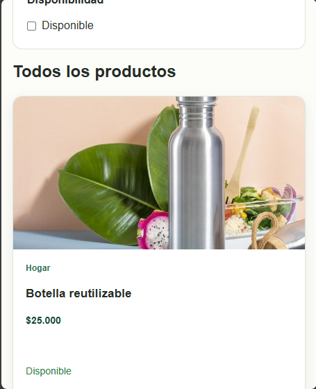

#### Sobre nosotros

**Mockup:**

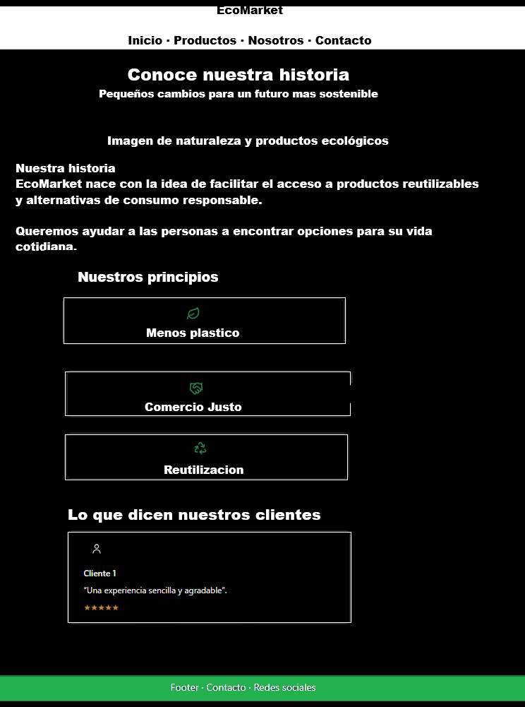

**Implementación:**

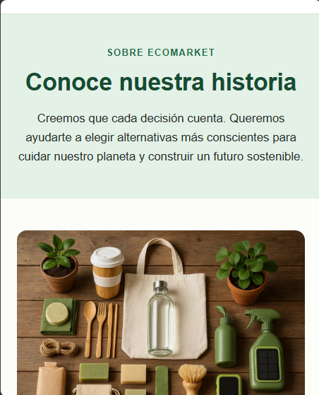

#### Contacto

**Mockup:**

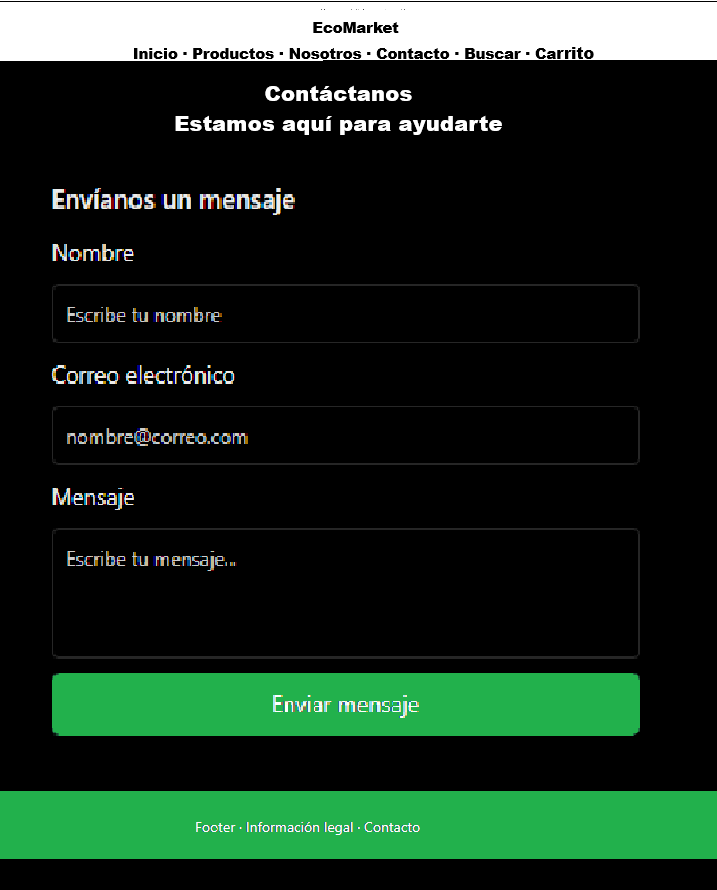

**Implementación:**

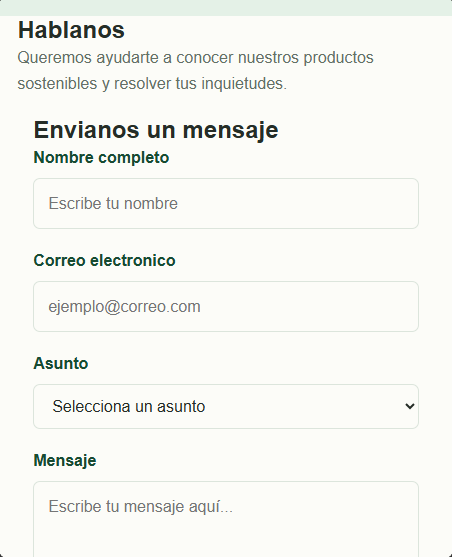

## 7. Autor

Juan Sebastian Sierra Velasco